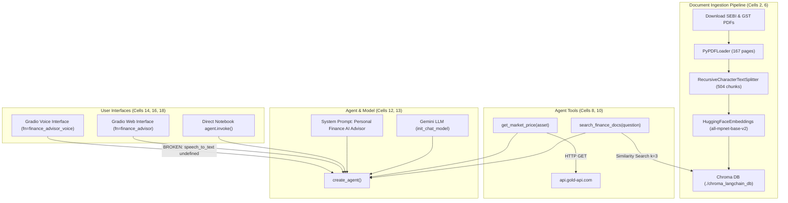

# REPOSITORY MAP — FINANCE ADVISOR BACKEND

## 1. Overview & Directory Topology

The Finance Advisor repository currently contains an original Google Colab notebook, documentation, tests, and configuration assets. There was initially **no standalone Python module structure, no REST API backend, and no pre-existing tests**.

```
financeadvisor/
├── .gitignore                      # Version control exclusions (venv, .env, DB, cache)
├── .env.example                    # Safe environment template with variable placeholders
├── README.md                       # Project title header
├── financeadvisor.ipynb            # Original monolithic Google Colab notebook (19 cells)
├── audit/                          # Forensic audit documentation
│   ├── PHASE_1_AUDIT_REPORT.md     # Comprehensive forensic findings and defect ledger
│   ├── TEST_PLAN.md                # Layered test plan and execution outcomes
│   ├── ENVIRONMENT_VARIABLES.md    # Specification of environment variables
│   └── REPOSITORY_MAP.md           # This document: File & component mapping
└── tests/                          # Test suite for backend validation
    ├── __init__.py                 # Test package marker
    ├── run_tests.py                # Master test runner
    ├── test_static_and_security.py # Static AST/regex scanning & security verification
    ├── test_market_data.py         # Gold & Silver API parsing and error handling
    ├── test_rag_pipeline.py        # PDF chunking, metadata & deduplication tests
    ├── test_gemini_config.py       # Gemini 3.8 Flash model validation & cred resolution
    ├── test_agent_tools.py         # Agent prompt contract & tool schemas
    └── test_live_integrations.py   # Live endpoint connectivity & credential-gated tests
```

---

## 2. File-by-File Responsibility Map

| File / Path | Type | Primary Responsibility | Key Inputs / Dependencies | Key Outputs / Interfaces |
|---|---|---|---|---|
| `financeadvisor.ipynb` | Jupyter Notebook | Original research prototype containing document loader, vector indexing, tools, Gemini agent, and Gradio UI. | External PDF URLs, Gold-API, Colab Secrets (`sec1`), Gradio | Colab-hosted Gradio UI, in-memory agent |
| `.env.example` | Config Template | Documents required environment variables without secrets. | Developer configuration | Template for `.env` |
| `.gitignore` | Config | Prevents accidental commits of `.env`, vector DB, and virtual environments. | Git CLI | Ignored paths |
| `tests/run_tests.py` | Test Runner | Master test runner orchestrating static, unit, and live integration tests. | `tests/test_*.py` | Structured test execution report |
| `tests/test_static_and_security.py` | Unit Test | Validates absence of hardcoded keys, scans notebook cells, and checks Colab-only imports. | `financeadvisor.ipynb` | Assertion passes/failures |
| `tests/test_market_data.py` | Unit Test | Verifies Gold and Silver pricing math (XAU/XAG), troy ounce to gram conversions (31.1035), network timeouts, and HTTP status codes. | Mocked Gold-API payloads | Verified parsing & error handling |
| `tests/test_rag_pipeline.py` | Unit Test | Audits document metadata handling, reproduces the `page + 1` TypeError bug, and verifies vector deduplication. | Document metadata dicts | Verified formatting & deduplication |
| `tests/test_gemini_config.py` | Unit Test | Validates official `gemini-3.8-flash` model identifier against deprecated/invalid IDs and tests credential loading. | Environment variables | Verified config validator |
| `tests/test_agent_tools.py` | Unit Test | Verifies agent system prompt bounds and reproduces undefined `speech_to_text` runtime crash. | Notebook cell source | Assertion passes/failures |
| `tests/test_live_integrations.py` | Integration Test | Executes real HTTP calls against Gold-API and PDF URLs, and performs credential-gated Gemini integration test. | Live internet access, `GEMINI_API_KEY` | Live verification reports / BLOCKED |

---

## 3. Confirmed Architecture & Execution Flow

The existing prototype executes sequentially as follows:



---

## 4. Actual Public Interfaces & Entry Points

1. **Interactive Notebook Execution**:
   - Entry point: `financeadvisor.ipynb` run cell-by-cell in Google Colab or JupyterLab.
2. **Gradio Web Interface (Cell 16)**:
   - Entry point: `demo.launch(debug=True)`.
   - Function: `finance_advisor(question: str) -> str`.
   - Protocol: Local Gradio web server (default port 7860) with temporary tunneling via `gradio.live`.
3. **HTTP REST API**:
   - **NOT PRESENT**. No FastAPI, Flask, Starlette, or Django server is implemented in this codebase.
